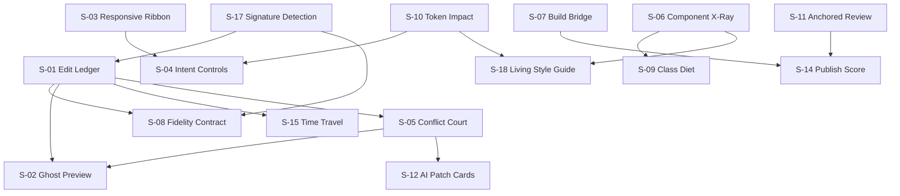
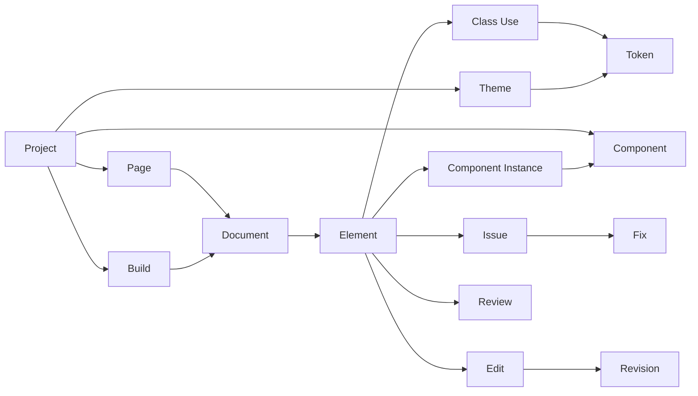
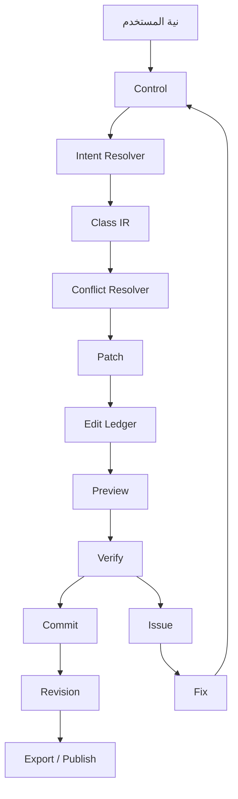

# 14 - خريطة العلاقات وتنظيم الأفكار

> الهدف: منع "قائمة ميزات" متناثرة. كل فكرة يجب أن ترتبط بمانع، بحل، بخوارزمية، بمعيار قياس، وبقرار.

## 1. سلسلة القيمة

```text
مستخدم يواجه مانعًا
      ↓
B-xx مانع موثق
      ↓
S-xx حل
      ↓
A-xx خوارزمية/آلية
      ↓
F-xx ميزة قابلة للتسليم
      ↓
M-xx مقياس نجاح
      ↓
D-xx قرار (نطاق/تأجيل/رفض)
```

أي فكرة لا تكمل السلسلة تُرفض أو تُؤجل.

## 2. مصفوفة التتبع

| المشكلة | المانع | الحل | الخوارزمية | الميزة | المقياس |
|---|---|---|---|---|---|
| P-01 class soup | B-10 | S-09, S-04 | A-10 | Class Diet / Intent | classes/element، وقت إعادة الهيكلة |
| P-02 ديناميكية | B-02, B-07 | S-01, S-07 | A-02, A-03 | Ledger + Build Bridge | 0 أصناف مفقودة |
| P-03 تعارض | B-03 | S-05 | A-04 | Conflict Court | 0 تعارض غير مفسر |
| P-04 ثيم | B-06 | S-04, S-10 | A-11 | Token Impact | % عناصر مربوطة بـ token |
| P-05 responsive | B-04 | S-03 | A-06 | Responsive Ribbon | وقت مهمة responsive |
| P-06 مكونات | B-05 | S-06 | A-09 | Component X-Ray | % صفحات تستخدم مكونات |
| P-07 إعادة هيكلة | B-10 | S-09 | A-10 | Class Diet | تكرار classes |
| P-08 build | B-07, B-15 | S-07, S-17 | A-07 | Build Bridge | دقائق معاينة قديمة |
| P-09 class لا يعمل | B-02 | S-01, S-05 | A-01, A-04 | Explain | % تعديلات مشروحة |
| P-10 جودة | B-09 | S-14 | A-14 | Quality Gate | issues/page |
| P-11 تصدير | B-01, B-07 | S-08, S-15 | A-16, A-13 | Fidelity Contract | 0 metadata في التصدير |
| P-12 مراجعة | B-12 | S-11 | — | Anchored Review | وقت دورة المراجعة |
| P-13 Figma | B-06 | S-10, S-18 | A-11 | Style Guide | % tokens متزامنة |
| P-14 AI | B-11 | S-12 | A-12 | Patch Cards | % patches صالحة |
| P-15 RTL | B-13 | S-13 | A-15 | Logical Mirror | RTL readiness |
| P-16 أداء | B-14 | S-17, S-07 | A-07 | Indexing | زمن فتح المشروع |

## 3. خريطة الاعتماد



### قواعد الاعتماد

1. لا Ghost بدون Ledger (نحتاج before/after).
2. لا Intent بدون Tokens (نحتاج مصدر قيم).
3. لا AI بدون Conflict Court (نحتاج تحقق).
4. لا Publish Score بدون Build Bridge (نحتاج تطابق).
5. لا Class Diet بدون X-Ray (نحتاج فهم البنية).

## 4. العلاقات بين الكائنات



### ثوابت العلاقات

| الثابت | المعنى | الاختبار |
|---|---|---|
| كل Element ينتمي إلى Document | لا عناصر معلقة | orphan scan |
| كل ClassUse يشير إلى token أو arbitrary | لا قيم صامتة | resolution audit |
| كل Edit يمس ملفًا واحدًا على الأقل | لا تعديل وهمي | patch validation |
| كل Issue له Fix أو تصنيف "يدوي" | لا تحذير بلا مخرج | fix coverage |
| كل Instance يشير إلى Component موجود | لا مراجع مكسورة | referential integrity |
| كل Token له مالك (theme) | لا قيم يتيمة | token audit |
| كل Revision لها parent أو root | تاريخ متصل | graph check |
| كل Build يرتبط بـ Document hash | تطابق المعاينة | parity check |

## 5. مصفوفة الأولوية

| الحل | الأثر | الجهد | الثقة | القرار |
|---|---|---|---|---|
| S-17 كشف بالبصمة | مرتفع | منخفض | مرتفعة | MVP |
| S-01 Ledger | مرتفع | متوسط | مرتفعة | MVP |
| S-02 Ghost | مرتفع | متوسط | متوسطة | MVP |
| S-05 Conflict Court | مرتفع | متوسط | مرتفعة | MVP |
| S-07 Build Bridge | مرتفع | متوسط | مرتفعة | MVP |
| S-08 Fidelity | مرتفع | متوسط | متوسطة | MVP |
| S-03 Responsive Ribbon | مرتفع | متوسط | متوسطة | MVP |
| S-06 X-Ray | مرتفع | مرتفع | مرتفعة | v1 |
| S-10 Token Impact | متوسط | متوسط | مرتفعة | v1 |
| S-13 RTL Mirror | مرتفع (سوقنا) | متوسط | مرتفعة | v1 |
| S-12 AI Cards | متوسط | متوسط | متوسطة | v1 |
| S-09 Class Diet | متوسط | متوسط | متوسطة | v1 |
| S-18 Style Guide | متوسط | متوسط | مرتفعة | v1 |
| S-11 Anchored Review | متوسط | متوسط | متوسطة | v1.5 |
| S-14 Publish Score | مرتفع | متوسط | مرتفعة | v1 |
| S-15 Time Travel | متوسط | متوسط | مرتفعة | v1.5 |
| S-04 Intent | مرتفع | متوسط | منخفضة | تجربة أولًا |
| S-16 Recipes | منخفض | منخفض | متوسطة | لاحقًا |

### ما نبدأ به

**الحزمة الأولى:** S-17 + S-08 + S-01 + S-02 + S-05 + S-07.

السبب: هذه الحزمة تحقق وعد "التعديل الآمن والمفهوم" وهي شرط لثقة المستخدم. بدونها، كل الميزات الأخرى تُبنى على أساس هش.

## 6. خريطة القرارات

| القرار | يؤثر على | يعتمد على | الموعد |
|---|---|---|---|
| D-01 Desktop | S-07, S-08, S-11 | مقابلات | Phase 0 |
| D-02 النطاق | كل الحلول | مقابلات | Phase 0 |
| D-03 محرك Tailwind | S-05, S-12, S-07 | PoC | Phase 0 |
| D-04 المكونات | S-06, S-09 | PoC | Phase 0 |
| D-05 الثيم | S-04, S-10 | PoC | Phase 2 |
| D-07 AI | S-12 | تحقق | Phase 4 |
| D-10 RTL | S-13 | مقابلات | Phase 0 |

## 7. حوكمة الأفكار

أي فكرة جديدة تمر بـ 7 أسئلة:

1. **أي مانع تحل؟** إن لم يوجد B-xx، فهي ليست أولوية.
2. **من يتأثر؟** شخصية محددة، لا "الجميع".
3. **كيف نقيسها؟** مقياس واحد على الأقل.
4. **ما أرخص نسخة؟** هل يمكن اختبارها في أسبوع؟
5. **ماذا نلغي؟** كل إضافة تطرح سؤال "ما الذي لن نبنيه؟".
6. **ما الخطر؟** تقني/UX/أمني.
7. **هل تخدم الوعد؟** "كل تعديل مشروح، آمن، وقابل للتسليم".

### نموذج تسجيل فكرة

```text
ID: I-xx
الاسم:
المانع: B-xx
الشخصية:
الوصف:
أرخص اختبار:
مقياس النجاح:
القرار: [MVP | v1 | لاحقًا | رفض]
سبب القرار:
```

### معايير الرفض

- "لأن المنافس يملكها" فقط.
- "قد تفيد أحدًا" بدون مانع.
- "توسع النطاق" دون حزمة.
- "تحتاج 3 أشهر قبل أي قيمة".
- "تتعارض مع الملكية أو الثقة".

## 8. العلاقة بين المستخدم والنظام



**القاعدة:** لا يوجد مسار يذهب من Control إلى Commit مباشرة. دائمًا هناك Ledger + Preview + Verify.

## 9. تجربة "الحلقة الثقة"

```text
1. أنوي (Intent)
2. أرى الأثر (Ghost)
3. أفهم السبب (Ledger)
4. أتحقق (Quality)
5. أثبّت (Commit)
6. أستعيد (Revision)
```

كل ميزة يجب أن تحسّن حلقة واحدة على الأقل دون كسر الأخرى.

## 10. لوحة القياس

| المقياس | التعريف | الهدف |
|---|---|---|
| TTFV | زمن أول قيمة (أول تعديل ناجح) | < 3 دقائق |
| TTB | زمن بناء صفحة كاملة | < 20 دقيقة |
| Explained Edits | % تعديلات لها تفسير | 100% |
| No-Op Rate | % تعديلات بلا أثر | < 1% |
| Conflict Escape | تعارضات تصل للمعاينة | 0 |
| Stale Preview | ثوانٍ تكون فيها المعاينة قديمة | < 2s |
| Import Fidelity | تطابق round-trip | > 99% |
| RTL Readiness | % utilities منطقية | > 95% |
| Quality Issues | issues/صفحة | < 3 |
| Publish Rollback | % نشر يحتاج تراجع | < 2% |
| Retention | استخدام أسبوعي | > 40% |

## 11. ما تعنيه هذه الخريطة

1. **لا ميزة بلا مانع.**
2. **لا مانع بلا قياس.**
3. **لا حل بلا اعتماد واضح.**
4. **لا AI بلا تحقق.**
5. **لا نشر بلا ثقة.**

هذه الخريطة هي المرجع عند أي نقاش "هل نضيف؟". إذا لم تُكمل السلسلة، فهي فكرة في الانتظار، لا في الخطة.
